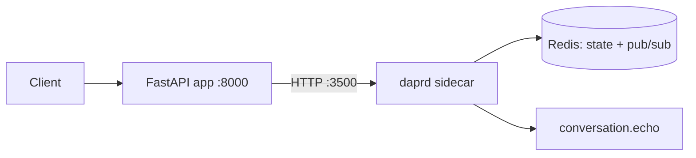

# dapr-building-block-APIs

Runnable sample applications that show how to use [Dapr](https://dapr.io/) building block APIs (state, pub/sub, service invocation, conversation) from a Python FastAPI app.

## Overview

Each sample lives under `example/` and has its own README with full details.

| Sample | Building blocks | Description |
|--------|-----------------|-------------|
| [simple-project](example/simple-project/README.md) | State management, pub/sub, service invocation | FastAPI app with a Dapr sidecar and Redis, run via Docker Compose |
| [llm-call-dapr](example/llm-call-dapr/README.md) | Conversation (LLM call) | FastAPI app calling the Dapr Conversation API using the offline `conversation.echo` component |

## Architecture



Redis is used by `simple-project`; the conversation component is used by `llm-call-dapr`. Each sample is deployed as an app container plus a `daprd` sidecar container (see each `docker-compose.yaml`).

## Prerequisites

- Python 3.11+ (per the sample READMEs and Dockerfiles)
- Docker and Docker Compose
- [Dapr CLI](https://docs.dapr.io/getting-started/install-dapr-cli/) (only for running outside Docker Compose)

## Quick start

```bash
cd example/simple-project      # or example/llm-call-dapr
docker-compose up --build
```

The app is served on `http://localhost:8000` (Swagger UI at `/docs`) and the Dapr HTTP API on `http://localhost:3500`. See the sample READMEs for endpoints, local `dapr run` commands and example requests.

## Repository structure

```
.
├── README.md
└── example/
    ├── simple-project/   # state, pub/sub, service invocation (+ Redis components)
    └── llm-call-dapr/    # Dapr Conversation API (conversation.echo component)
```

Each sample contains `main.py`, `example_client.py`, `Dockerfile`, `docker-compose.yaml`, `Makefile`, `setup.sh`, `requirements.txt` and a `dapr-components/` directory.

## Configuration

Configuration is per sample; see the sample READMEs. `llm-call-dapr` reads `APP_PORT`, `DAPR_HOST`, `DAPR_HTTP_PORT`, `CONVERSATION_COMPONENT`, `DEFAULT_SYSTEM_PROMPT` and `USE_MOCK` from the environment. `simple-project` provides a `.env.example` (no secrets).

## Related

- [Dapr Agents](https://github.com/dapr/dapr-agents)
- [Community Dapr samples](https://github.com/dapr/samples)
- [Dapr documentation](https://docs.dapr.io/)

## License

[MIT](LICENSE)

## Author

Umesh Khatiwada - https://github.com/umesh-khatiwada
